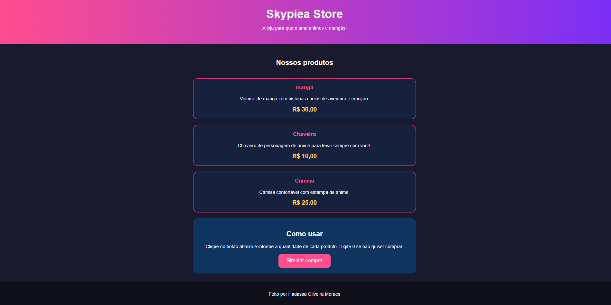

# Skypiea Store

**Aluno:** Hadassa oliveira Moraes
**Trilha:** Desenvolvimento mobile

## Sobre a loja
A Skypiea Store é uma loja fictícia de animes. A página apresenta os produtos
e permite simular uma compra: o usuário informa a quantidade de cada item e
recebe o valor de cada produto e o total.

## Produtos e preços
| Produto  | Descrição                                      | Preço    |
|----------|------------------------------------------------|----------|
| Mangá    | Volume de mangá com histórias cheias de aventura | R$ 30,00 |
| Chaveiro | Chaveiro de personagem de anime                 | R$ 10,00 |
| Camisa   | Camisa confortável com estampa de anime         | R$ 25,00 |

## Tecnologias
- HTML
- CSS
- JavaScript

## Como executar
1. Baixe ou clone o projeto.
2. Abra o arquivo `index.html` no navegador.
3. Clique em "Simular compra" e responda às perguntas.

## Captura de tela

## Testes realizados
| Teste | Quantidades (mangá, chaveiro, camisa) | Resultado |
|-------|----------------------------------------|-----------|
| 1 | 2, 1, 3 | Total de R$ 145,00 (correto) |
| 2 | 0, 0, 0 | Exibiu "Nenhum produto foi selecionado." |
| 3 | 0, 5, 0 | Total de R$ 50,00 (correto) |

## Dificuldade e aprendizado
Minha maior dificuldade foi o CSS não funcionar. O problema era uma aspa
que faltou na linha do `<meta name="viewport">` no `index.html`, o que fez o
navegador ignorar a linha que conecta o `style.css`. Aprendi que um detalhe
pequeno de sintaxe pode quebrar o código inteiro e que vale a pena conferir
cada linha com calma.